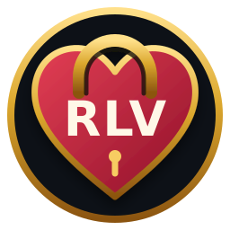

  
  &nbsp;&nbsp;&nbsp;
  

<h1 align="center">Firestorm RLV-E</h1>

Firestorm RLV-E is an unofficial fork of the [Firestorm Viewer](https://github.com/FirestormViewer/phoenix-firestorm) focused on expanding consensual RLV play with remote wardrobe, attachment, and restriction controls.

It adds viewer-native remote RLV floaters and extends the Firestorm LSL Bridge so an authorized relay can expose useful wardrobe and restriction state without requiring separate controller HUDs.

> [!IMPORTANT]
> This project is not the official Firestorm Viewer and is not supported by the Firestorm team. For the original source, official releases, documentation, and support, visit the [Firestorm Viewer repository](https://github.com/FirestormViewer/phoenix-firestorm) or [firestormviewer.org](https://www.firestormviewer.org).

## RLV-E additions

### Remote RLV Wardrobe

- Browse the target's shared `#RLV` folder hierarchy and worn-state summaries
- Attach, replace, or detach shared folders through standard RLV commands
- Inspect visible worn attachments and occupied attachment points
- Refresh individual folders or the complete remote wardrobe

### Remote RLV Restrictions

- Toggle common chat, movement, teleport, interaction, privacy, camera, clothing, and attachment restrictions
- Distinguish restrictions owned by the target relay from rules applied by other RLV objects
- Inspect aggregate active rules, occupied attachment points, and available lock information
- Release the curated restrictions owned by the relay without clearing unrelated restrictions

### Shared remote session

- Selecting a person in either remote RLV floater selects them in both
- Open floaters refresh automatically; closed floaters retain the selection for their next opening
- Requests are serialized through the Firestorm LSL Bridge to avoid competing relay sessions
- Bridge replies are memory-safe chunked for large restriction and inventory responses

## Requirements and privacy boundaries

Remote controls require:

- RLV enabled on the target's viewer
- An enabled RLV relay worn by the target
- Relay permission for the controller
- Both avatars in the same region and within reply range
- A working Firestorm LSL Bridge on the controller

Standard RLV exposes shared **folder names** and folder-level worn summaries, but it does not provide a way to enumerate every inventory item inside another avatar's folders. RLV-E can show visible worn attachment names and occupied points, while unnamed or unworn inventory remains private. Similarly, aggregate restriction queries do not disclose the exact foreign object responsible for every rule.

These limitations are intentional: RLV-E uses the existing RLV permission and relay model rather than bypassing the target viewer's consent or inventory privacy.

## Upstream

Firestorm RLV-E tracks [FirestormViewer/phoenix-firestorm](https://github.com/FirestormViewer/phoenix-firestorm) as its upstream project. Firestorm itself is a third-party viewer derived from the official [Second Life Viewer](https://github.com/secondlife/viewer).

Changes that are generally useful to Firestorm should be proposed to the original project according to its [contribution guidelines](https://github.com/FirestormViewer/phoenix-firestorm/blob/master/CONTRIBUTING.md).

## Build instructions

The existing Firestorm build documentation is included in this repository:

- [Windows](doc/building_windows.md)
- [macOS](doc/building_macos.md)
- [Linux](doc/building_linux.md)

Additional upstream documentation is available in the official [Firestorm wiki](https://wiki.firestormviewer.org).

## License

Firestorm RLV-E is distributed under the same open-source licensing terms as its upstream Firestorm codebase. See [LICENSE](LICENSE) and the source-file headers for details.

## Community standards

Use of this viewer and contributions to this repository should follow the [Second Life Third Party Viewer Policy](https://secondlife.com/corporate/third-party-viewers) and the [Second Life Code of Conduct](https://github.com/secondlife/viewer?tab=coc-ov-file).
